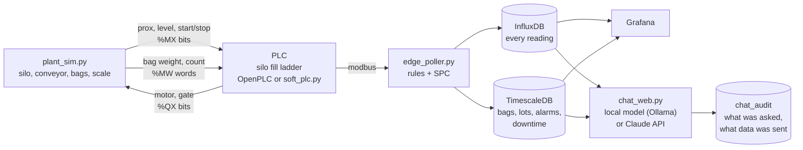

# Fertilizer bagging line (simulated)

A silo fills 50 lb bags of fertilizer on a conveyor. the PLC runs the fill with the ladder from the silo lab. an edge poller reads the PLC, weighs every bag against the label, ties it to a lot and a shift, and raises an alarm when something drifts. A dashboard shows the line, and you can ask questions about it in English, with a local model by default so nothing leaves the building.

Everything is simulated and runs on one laptop in docker. the company, Brightfield Fertilizer, is made up.

This is episode 2 of a series on what an AI builder does with the labs in a PLC course (Johnston Community College, Advanced Manufacturing Training Facility, Four Oaks NC). episode 1 was the [garage door](https://github.com/gigimcc4/PLC-yolo-garagedoor).

## Why fertilizer

Fertilizer is a regulated product. In North Carolina, inspectors sample it where it's sold, and a product that tests short of its guaranteed analysis brings penalties and can get a stop-sale order ([NCDA&CS](https://www.ncagr.gov/divisions/plant-industry/seed-and-fertilizer/inspections-compliance), [G.S. 106-665](https://ncleg.gov/EnactedLegislation/Statutes/HTML/BySection/Chapter_106/GS_106-665.html)). Packaged net weight is checked separately, using the procedures in [NIST Handbook 133](https://www.nist.gov/document/00-20-h133-titlefinaldocx).

Plus my B.S. is in horticulture and I love love love to talk soil and soil amendments.

A bagging line sits between two costs:

- **short bags** are a compliance problem
- **overfilled bags** are product given away for free, a fraction of a pound at a time, thousands of times a day

This demo keeps the records that let a plant answer "which lot, which shift, what were the fills" when someone asks. the fill line controls weight, not nutrient analysis (that comes from blending upstream), and nothing here makes a plant compliant. it's a demo of the record keeping.

## How it works



- **The PLC** runs the same six rungs as the silo lab. bag arrives, gate opens, level sensor trips, bag moves on
- **Plant_sim** plays everything physical: the silo draining and refilling, the gate's flow, the bag filling, the scale. it writes each bag's net weight into PLC memory, the way a scale wired to the PLC would
- **The edge poller** does all the checking with plain rules and statistics, every half second. no model is called per tick
- **The chat** only reads what the poller already recorded, and logs every question with the exact data that was sent to the model

## What the poller catches

| alarm | what happened | how it's found |
| --- | --- | --- |
| `short_fill` | bag under 49.5 lb | scale weight vs limit |
| `overfill` | bag over 51.5 lb, giveaway | scale weight vs limit |
| `spc` on fill time | gate caking, flow dropping | fill time drifts from the lot's baseline, its first 30 bags (z-score). shows up first, because the level sensor still stops each bag near the right weight. bags do get a little lighter, since less product is in the air when the gate shuts |
| `spc` on weight | level sensor drifting | weight drifts from the lot's baseline, before or right as it crosses the short limit |
| `fill_timeout` | gate open 12+ s | stuck sensor, empty silo, blocked gate |
| `starved` | running, no bag for 25 s | silo empty, nothing to fill |
| `silo_low` | silo under 15% | refill late |

limits are in `config.py` and `.env`.

## Scenarios

fire these while it runs and watch the dashboard and the alarms:

```
./run.sh event clog       # gate cakes up over ~3 min. fill time climbs, bags/min drops
./run.sh event drift      # level sensor drifts over ~2 min. bags start coming out short
./run.sh event silo_low   # refill truck is 90 s late. silo runs dry, line starves
./run.sh event stuck      # level sensor stuck off for 20 s. gate stays open, bag overfills
./run.sh event clear      # maintenance: clean gate, recalibrate, refill on time
./run.sh event stop       # operator presses stop
./run.sh event start      # operator presses start
```

`./run.sh seed` writes two weeks of history with three stories in it (a gate clog over a few days, a sensor drift that put a couple hundred short bags into one lot, a late refill) so there's something to ask about.

## Questions to try in chat with data

- is the bagging line healthy right now?
- which lots had short fills in the last two weeks, and on which shift?
- how much product did we give away last week?
- why were fill times high last week, and what fixed it?
- how many short bags are in the current lot?

turn on "show the data the model saw" to see exactly what went to the model. every answer is also in the `chat_audit` table (Data tab).

## what's in here

| path | what it is |
| --- | --- |
| `plc/` | the OpenPLC Editor project (silo fill ladder, exercise 3) and `main_ladder.st`, the same ladder as text |
| `soft_plc.py` | the same ladder in python, for running without OpenPLC |
| `plant_sim.py` | the line around the PLC, and the scenarios |
| `edge_poller.py` | reads the PLC, checks every bag, writes InfluxDB + sql |
| `db.py`, `sql/schema.sql` | the sql layer: lots, bags, alarms, downtime, chat audit, eval |
| `chat_health.py`, `chat_web.py` | chat in the terminal or the browser |
| `backfill.py` | two weeks of seeded history |
| `lot.py` | start a new lot |
| `eval/` | scores the chat against answers computed from the data |
| `grafana/` | dashboard and data sources, loaded on start |
| `config.py`, `.env.example` | every setting in one place |
| `docker-compose.yml`, `Dockerfile` | the whole stack |
| `docs/DATA_DICTIONARY.md` | every table, field and tag |

## Start

see [SETUP.md](SETUP.md). the short version, with Docker Desktop running:

```
cp .env.example .env      # then change the passwords
./run.sh up
```

dashboard at http://localhost:3000, chat at http://localhost:8600.

## The ladder

```
rung 1  run_light  := (start OR run_light) AND stop
rung 2  full_light := (level OR full_light) AND prox
rung 3  motor      := run_light AND (NOT prox
                        OR (full_light AND (mode_a OR ((mode_b OR mode_c) AND release))))
rung 4  solenoid   := (mode_a OR mode_b) AND run_light AND prox AND NOT full_light
rung 5  fill_light := solenoid
rung 6  release    := (start OR release) AND full_light AND prox
```

| variable | location | modbus | written by |
| --- | --- | --- | --- |
| start | %MX0.0 | coil 8192 | plant_sim (operator) |
| stop | %MX0.1 | coil 8193 | plant_sim. normally closed: TRUE = not pressed |
| prox | %MX0.2 | coil 8194 | plant_sim |
| level | %MX0.3 | coil 8195 | plant_sim |
| mode_a / mode_b / mode_c | %MX0.4-0.6 | coils 8196-8198 | plant_sim (`LINE_MODE` in .env) |
| motor | %QX0.0 | coil 0 | PLC |
| solenoid (gate) | %QX0.1 | coil 1 | PLC |
| run_light | %QX0.2 | coil 2 | PLC |
| fill_light | %QX0.3 | coil 3 | PLC |
| full_light | %QX0.4 | coil 4 | PLC |
| bag net lb x10 | %MW0 | holding 1024 | plant_sim (scale) |
| bag count | %MW1 | holding 1025 | plant_sim (scale) |
| fill time, tenths of a second | %MW2 | holding 1026 | plant_sim |
| silo % | %MW3 | holding 1027 | plant_sim |
| gate flow lb/s x10 | %MW4 | holding 1028 | plant_sim |

In the lab, the inputs were `%IX`. here they are `%MX`, because python can only write PLC memory over modbus, not physical inputs. 

## Limits

- **simulated.** the silo, bags and scale are python. nothing here is safety-rated or meant to run equipment
- **not a compliance system.** the short and over limits are demo numbers, not the tolerances in NIST Handbook 133 or state rules. a plant would set them from those, with its own checkweigher
- **mode C stalls.** in mode C the gate never opens, so `full_light` never comes on, so `release` and `motor` never fire and the bag sits at the spout. the lab ladder does the same. modes A and B work
- **fill timeout lives in the poller, not the ladder.** on a production line a stuck gate would also be stopped by the PLC (a timer and a fault). the poller records it; it doesn't stop anything
- **the chat is only as good as its data block.** it can answer about lots, shifts, days and the live window. it can't answer about a time range the block doesn't include. `eval/` is there to measure that

## Shut down

```
./run.sh down          # stop, keep the data
docker compose down -v # stop and delete the data
```

## credits and licenses

- [OpenPLC](https://autonomylogic.com/) runtime and editor
- [InfluxDB](https://www.influxdata.com/), [TimescaleDB](https://www.timescale.com/), [Grafana](https://grafana.com/)
- [pymodbus](https://github.com/pymodbus-dev/pymodbus)
- [Ollama](https://ollama.com/) for the local model, or any proprietary model

built by Dr. Jeanne McClure, Ars Innovate Technologies. MIT license.
